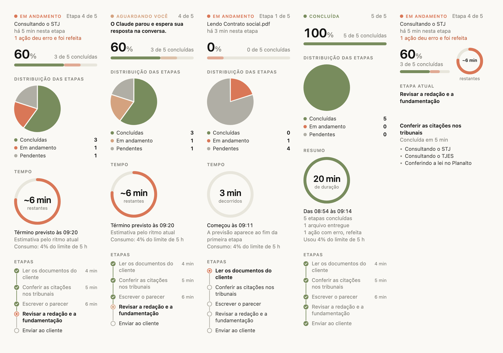

# Andamento da tarefa (progresso-da-tarefa)

Mod do Claude Code que mostra, em linguagem simples, quanto da tarefa em andamento na sessão já foi feito e quanto falta.

<picture>
  <source media="(prefers-color-scheme: dark)" srcset="docs/tela-escuro.png">
  
</picture>

Tema claro: [docs/tela-claro.png](docs/tela-claro.png). Tema escuro: [docs/tela-escuro.png](docs/tela-escuro.png).

## O que aparece

Uma coluna estreita (cerca de 200 px), lida de cima para baixo, desenhada com a paleta da Anthropic (verde oliva para concluída, laranja do Claude para em andamento, kraft para esperando você, cinzas quentes para o resto; nenhum azul):

1. **Estado**: em andamento, aguardando você (o Claude parou e espera sua resposta) ou concluída, e a etapa da vez ("Etapa 4 de 5"). Logo abaixo, em palavras comuns, o que está sendo feito agora ("Consultando o STJ", "Escrevendo Parecer.docx"), há quanto tempo na etapa atual e quantas ações deram erro e foram refeitas.
2. **Percentual e barra**: etapas concluídas sobre o total, um único cálculo usado em todo o Mod. A barra mostra o feito e, em laranja claro, a etapa em andamento.
3. **Pizza**: concluídas, em andamento e pendentes, com a tabela das quantidades logo abaixo.
4. **Círculo do tempo**, com o mesmo traço da barra: a previsão de término pelo ritmo das etapas já concluídas; antes da primeira terminar, o tempo decorrido; concluída, a duração total.
5. **Etapas**: linha do tempo vertical com as concluídas, a atual em destaque e as próximas.
6. **Faixa acima da caixa de texto**: uma linha com o percentual, a etapa e o tempo, e o botão "Ver painel"; quando a vez é sua, ela avisa.
7. **Arquivos entregues**: cada arquivo criado ou alterado na tarefa, com botão para abrir.
8. **Resumo ao concluir**: horário de início e fim, etapas, arquivos, ações com erro e quanto do limite de 5 horas a tarefa usou.
9. **Uso do plano**: dois anéis com o percentual já usado da sessão atual (limite de 5 horas) e da semana, quando cada um renova e o gasto da conversa, atualizados sempre que mudam.

## Botões no painel

No fim do painel, juntos: "Recolher" (reduz o painel a percentual, círculo e etapa atual) e "Parar o Claude" (interrompe o trabalho em curso). Acima deles, "Ver o que foi feito numa etapa" mostra a lista do que o Claude fez na etapa escolhida, e os arquivos criados ou alterados na tarefa aparecem listados pelo nome.

## Avisos

Aviso na tela do Claude Code quando a tarefa termina e quando o Claude para esperando você.

## Memória entre sessões

O andamento fica guardado por sessão (por até 14 dias): retomar uma sessão traz o painel como estava.

Todos os indicadores saem de um só retrato do estado, então mudam juntos. Ao concluir, estimativas e barras de andamento dão lugar à duração total.

O painel abre sozinho quando o Claude monta uma lista com duas ou mais etapas (se você o fechou, não volta a abrir sozinho na mesma sessão).

## Comandos

`/progresso` abre ou fecha o painel.

## De onde vêm os dados

Da lista de etapas que o Claude mantém na sessão: a do app (abaixo das mensagens, na aba Code) e a do terminal (TodoWrite, TaskCreate e TaskUpdate).

## O que o Mod lê, guarda e faz

1. **Ganchos nas chamadas de ferramenta (`tool.call`).** O Mod observa toda chamada de ferramenta da sessão, inclusive as de servidores MCP e de comandos do terminal, só para ler o nome da ferramenta e o caminho do arquivo gravado, e com isso escrever em português o que está sendo feito ("Consultando o STJ", "Escrevendo Parecer.docx") e listar os arquivos da tarefa. Ele repassa cada chamada sem alterá-la, sem bloqueá-la e sem responder no lugar da ferramenta. Nas cinco ferramentas da lista de etapas (`mcp__ccd_turn__update_plan`, `mcp__ccd_turn__wrap_up`, `TodoWrite`, `TaskCreate`, `TaskUpdate`) ele lê as etapas e a situação de cada uma.
2. **Pedido e turnos (`prompt.submit`, `turn.start`, `turn.complete`).** Guarda o texto do seu último pedido para dar nome à tarefa e percebe quando o Claude parou esperando você. Não altera o pedido.
3. **Limites de uso.** Lê o percentual já usado dos limites de 5 horas e semanal da sua conta, a data de renovação de cada um e o gasto da conversa, que o próprio Claude Code informa, para mostrar quanto a tarefa e a semana consumiram. Não lê nem usa senha, chave ou token.
4. **Memória.** Guarda o andamento de cada sessão no armazenamento do próprio Mod no Claude Code, por até 14 dias, e apaga o que for mais antigo.
5. **O que ele não faz.** Não acessa a rede, não envia dados a lugar nenhum, não executa programas, não chama ferramentas por conta própria e não decide permissões: tudo o que ele lê fica no painel, no seu computador. O botão "Parar o Claude" só interrompe o turno em curso quando você o aperta.

## Onde funciona

Terminal e aba Code do app Desktop (no terminal, a pizza e o círculo são desenhados com blocos coloridos), e o painel também na extensão do VS Code. Não aparece no Chat nem no Cowork.

## Instalar

No terminal, na caixa de texto do Claude Code:

```
/plugin install progresso-da-tarefa --marketplace mauro-massucatti/progresso-da-tarefa
```

Responda `y` para adicionar o marketplace e escolha o escopo. Pelo shell:

```bash
claude plugin install progresso-da-tarefa --marketplace mauro-massucatti/progresso-da-tarefa
```

No app Desktop, onde `/plugin` não funciona: clique em + ao lado da caixa de texto, depois Plugins, Add marketplace com `mauro-massucatti/progresso-da-tarefa` e Add plugin.

## Licença

MIT. Veja [LICENSE](LICENSE).
